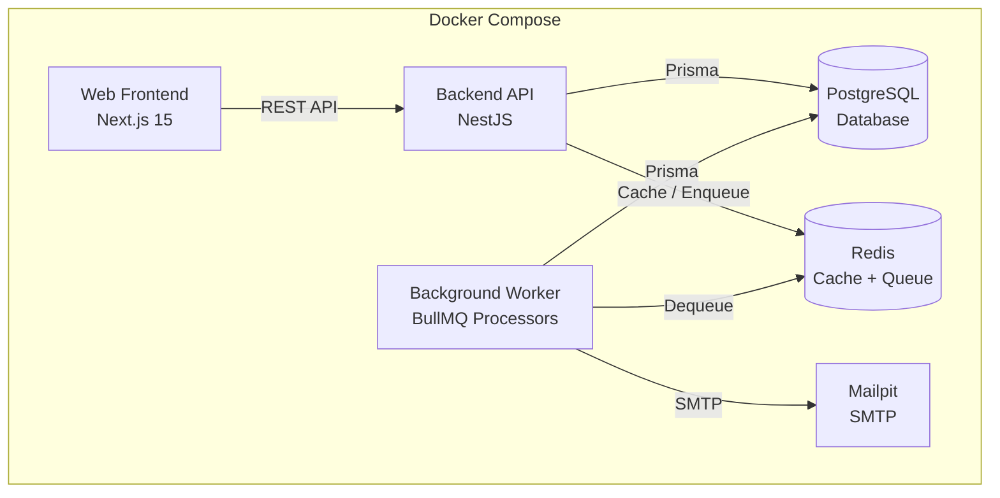

# Architecture — Azatech Shop

## Overview

The system is a monorepo with two services (API + Web) sharing a PostgreSQL database, Redis for cache/queue, and Mailpit for local email testing. Both services run independently and can scale separately.

## Architecture Diagram



## Layer Structure

```
src/
├── common/          # Cross-cutting concerns
│   ├── prisma/       # Database connection (PrismaService)
│   ├── redis/        # Redis connection + cache helpers
│   ├── guards/       # JWT auth guard, RBAC roles guard
│   ├── filters/      # Global exception filter (consistent JSON errors)
│   ├── interceptors/ # Response transform, request-id
│   ├── decorators/   # @Roles(), @CurrentUser()
│   └── dto/          # Pagination DTO
├── auth/             # Authentication module
│   ├── strategies/   # Passport JWT strategy
│   └── dto/          # Login, refresh DTOs
├── products/         # Product domain
├── customers/        # Customer domain
├── orders/           # Order domain (core business logic)
│   ├── order-state-machine.ts   # State machine (single source of truth)
│   ├── idempotency.service.ts  # Idempotency key management
│   └── order-number.generator.ts
├── reports/          # Sales + top products reporting
├── dashboard/         # Cached summary
├── queue/            # BullMQ workers (invoice, notifications)
├── notifications/    # Mail service (Nodemailer)
└── config/           # Environment config loaders
```

**Why this structure:**

- **Feature-based modules**: Each domain (products, orders, etc.) is self-contained with its own controller, service, and DTOs. This keeps related code together and makes it easy to find.
- **Common shared utilities**: Cross-cutting concerns (guards, filters, interceptors) live in `common/` and are registered globally.
- **State machine as domain logic**: The order state machine is a standalone class, not embedded in the controller. This makes it testable in isolation and reusable.
- **Idempotency as a service**: Separated from order creation logic so it can be tested independently and potentially applied to other endpoints.

If the application grows larger, I would:
- Split into independent npm packages (e.g., `@azatech/shared-types`, `@azatech/common`)
- Extract the state machine into its own package for reuse across services
- Move to a modular monolith or microservices pattern (order service, inventory service, reporting service)
- Add an API gateway for routing and rate limiting

## ADRs (Architecture Decision Records)

### ADR-1: Stock Consistency Strategy

**Context:** Multiple cashiers can create orders simultaneously for the same product. The system must never oversell (stock must not go negative). Orders are multi-item, so deadlock risk exists.

**Options Considered:**

1. **Optimistic Locking with Retry**: Use a version column, retry on conflict. Simple, no locks held. But under high contention on popular products, many retries waste resources.
2. **Conditional Atomic Update**: `UPDATE products SET stock = stock - qty WHERE stock >= qty`. Fast, atomic. But doesn't return the locked row's state, making it harder to record accurate stock_after in the ledger within the same transaction.
3. **Pessimistic Locking (SELECT FOR UPDATE)**: Explicitly lock product rows during the transaction. Clear and explicit. Locks held for the transaction duration.

**Decision:** Pessimistic locking with `SELECT ... FOR UPDATE`, acquiring locks in ascending product_id order.

**Rationale:**
- Online shop with concurrent orders on popular items → high contention on specific products
- Optimistic locking would cause many retries under load (wasteful)
- PostgreSQL row-level locks are cheap for typical order sizes (<10 items)
- Ordering locks by product_id prevents circular wait deadlocks (all transactions lock in the same order)

**Consequences:**
- Holding locks reduces throughput slightly under extreme contention
- Must always acquire locks in sorted order to avoid deadlocks
- Lock timeout (10s) prevents indefinite blocking

### ADR-2: Idempotency Design

**Context:** POST /api/orders must be idempotent to handle network retries. Client sends `Idempotency-Key` header (UUID). Same key + same payload = same response. Same key + different payload = rejected.

**Options Considered:**

1. **Redis-only**: Store key → response mapping in Redis with TTL. Fast, simple. But Redis is not the source of truth for orders — if Redis restarts, idempotency is lost.
2. **Database table**: Store idempotency keys in PostgreSQL with payload, status, and response. Durable, consistent with order data. Slightly slower than Redis.
3. **Hybrid (Redis + DB)**: Redis for fast lookup, DB for durability. Complex.

**Decision:** Database-backed idempotency table with TTL (24 hours).

**Implementation Details:**
- `idempotency_keys` table stores: key, payload (JSON), status (processing/completed/failed), response (JSON), expires_at
- On request: check if key exists and is completed → return cached response
- If key exists but status=processing → return 409 (request in flight)
- If key exists with different payload → return 422 (key reuse with different data)
- If key is new → mark as processing, create order, mark as completed with response
- On error: mark as failed (can be retried with new key)

**Rationale:**
- PostgreSQL is the source of truth, so idempotency state should live there
- 24-hour TTL balances durability vs storage growth
- 422 for payload mismatch (not 409) because 422 is "semantic error" — the key is valid but the payload is semantically inconsistent

**Consequences:**
- Extra DB write per order creation
- Periodic cleanup of expired keys needed
- 422 choice may differ from some clients' expectations; documented in API docs

### ADR-3: Authentication Strategy

**Context:** The system needs stateless authentication with short-lived access tokens and the ability to revoke sessions on logout. Two roles (admin, cashier) need role-based authorization.

**Options Considered:**

1. **Access token only (no refresh)**: Simple. But long-lived tokens can't be revoked.
2. **JWT access + refresh with database rotation**: Short-lived access token (15m), long-lived refresh token (7d). Refresh tokens stored in DB, rotated on use, revoked on logout.
3. **Session-based (server-side sessions)**: Most secure. But requires sticky sessions or shared session store, adds complexity for a REST API.

**Decision:** JWT access + refresh tokens with database-backed rotation.

**Implementation:**
- Access token: 15 min expiry, signed with `JWT_SECRET`, type="access"
- Refresh token: 7 day expiry, signed with `JWT_REFRESH_SECRET`, type="refresh"
- Refresh tokens stored in `refresh_tokens` table with `revoked` flag
- On refresh: verify token, check not revoked, revoke old token, issue new pair (rotation)
- On logout: revoke all refresh tokens for the user
- Old refresh tokens cannot be reused (revoked after rotation)

**Rationale:**
- Short access tokens limit exposure window
- Refresh rotation detects token theft (reused token = already revoked)
- Database storage enables explicit revocation on logout
- Frontend auto-refreshes on 401 via interceptor

**Consequences:**
- Refresh token rotation requires a DB write per refresh
- If refresh token is stolen and used first, legitimate user gets logged out (acceptable trade-off for security)
- Token cleanup needed for expired tokens

## Scaling to 50,000 Orders/Day from Multiple Branches

If the system needs to handle 50,000 orders/day from many branches:

1. **Database**: 
   - Add read replicas for reporting queries (writes go to primary, reads from replicas)
   - Partition orders table by date (monthly partitions)
   - Connection pooling with PgBouncer
   - Consider sharding by branch_id if order volume grows further

2. **API**: 
   - Horizontal scaling behind a load balancer (stateless API instances)
   - Split write-heavy endpoints (order creation) from read-heavy endpoints (reports, dashboard)
   - Move reporting to a separate service with its own read replica

3. **Queue/Worker**: 
   - Scale worker instances independently
   - Separate queues by priority (invoice generation vs notifications)
   - Dead letter queue for permanently failed jobs

4. **Cache**: 
   - Multi-level caching: local cache (in-memory) + Redis
   - Cache common dashboard summaries per branch
   - Use Redis Streams for event sourcing if needed

5. **Multi-branch**: 
   - Add `branch_id` to products, orders, users
   - Row-level security policies in PostgreSQL per branch
   - Branch-specific stock and order numbers
   - Centralized reporting with branch aggregation

6. **Observability**: 
   - Add OpenTelemetry tracing across services
   - Prometheus metrics for order throughput, stock levels, job queue depth
   - Structured alerts for low stock, failed jobs, error spikes

## Decisions

### a. How do I prevent stock from going negative when two orders arrive simultaneously?

I use **pessimistic row-level locking** (`SELECT ... FOR UPDATE`) inside a database transaction. When an order is created, I lock each product row in ascending `product_id` order, check stock availability, deduct it, and record the movement — all within the same transaction. The sorted lock order ensures that concurrent multi-item orders always acquire locks in the same order, preventing circular-wait deadlocks.

File: `apps/api/src/orders/orders.service.ts`, method `createOrderInternal`

### b. Why is the folder and layer structure the way it is, and what would I change if the app grows?

The structure is feature-based: each domain (auth, products, customers, orders, etc.) is a self-contained NestJS module with its own controller, service, and DTOs. Shared cross-cutting concerns (guards, filters, interceptors, database connection) live in `common/`. This keeps related code together and makes navigation intuitive.

If the app grows: I'd extract shared types into a package, split the monolith into bounded-context services (inventory, ordering, reporting), add an API gateway, and use event-driven communication between services. I'd also add a dedicated audit-log table and move to a CQRS pattern for complex reporting.

### c. A bug or problem I encountered, and how I found it

During development of the order creation, I noticed that Prisma's `$transaction` with interactive transactions doesn't support `SELECT ... FOR UPDATE` natively — Prisma's client API doesn't expose row-level locks. I solved this by using `tx.$queryRaw` with raw SQL to lock the product rows, then using Prisma's typed API for the rest of the transaction. This gives me both the locking guarantee and type safety for the updates.

File: `apps/api/src/orders/orders.service.ts`, `createOrderInternal` method — the `tx.$queryRaw` blocks with `FOR UPDATE`.

### d. Parts that are unfinished or weak, and next steps

- **Frontend forms**: Product create/update forms are not fully built in the frontend (the API endpoints exist and are tested). Next step: build form components with Zod validation matching the backend.
- **Playwright E2E**: Not implemented. Next step: add Playwright tests covering the order creation → payment → cancellation flow.
- **Audit log**: Stock movements serve as a partial audit trail. Next step: add a dedicated `audit_logs` table for product deletion, order cancellation, and stock adjustments with before/after snapshots.
- **Report export**: CSV/Excel export not implemented. Next step: add a background job that generates and emails the report.
- **Rate limiting**: Basic throttle is in place but could be more granular per endpoint.
